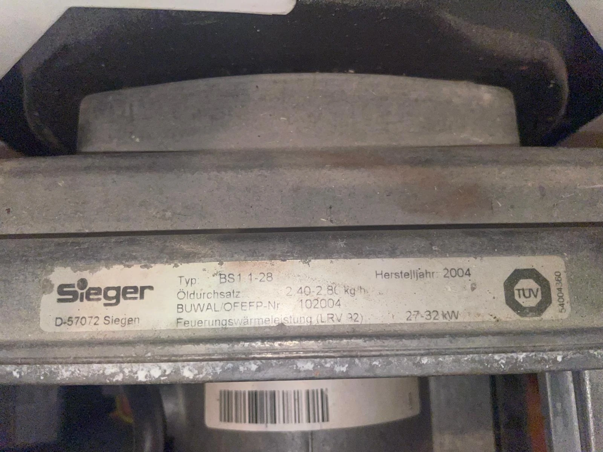
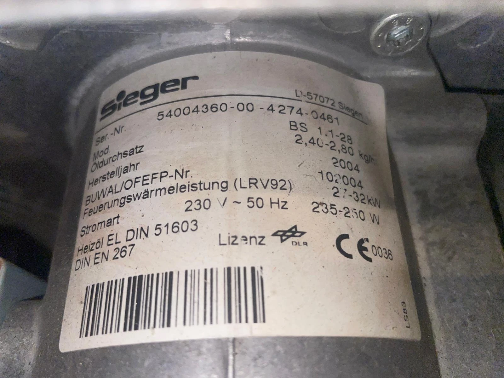

# Heizungsanlage: Kessel, Brenner, Wartungswerte

Stand 21.11.2026. Typenschilder vor Ort abfotografiert, Wartungswerte aus dem Wartungs- und
Messprotokoll 2020. Regler und Registerbelegung: [REGLERVERHALTEN.md](REGLERVERHALTEN.md).

## Übersicht

| Komponente | Gerät | Kennwerte |
|---|---|---|
| Kessel | Sieger **TT 11** (Öl-Stahlheizkessel) | Pn 22–28 kW, Qn 24,2–30,8 kW, 67 l |
| Brenner | Sieger **BS 1.1-28** (Bj. 2004) | Schild: 2,40–2,80 kg/h, 27–32 kW, 235–250 W |
| **Eingestellt (Wartung 2020)** | Düse **0,55 gph 60° HTD** | **2,12 kg/h ≈ 25,1 kW Feuerung**, Wirkungsgrad **91,4 %** |
| Regler | OEG KMS-D, Hydraulikschema 107b | siehe REGLERVERHALTEN.md |
| Fußbodenheizung | Mischerkreis (Kreis 1), Pumpe R2 | Vorlauf ≈ 23–31 °C |
| Warmwasser | Speicher mit Solar (T5 oben, T6 unten) | Soll 52 °C, Legionellenschutz Fr 05 Uhr |

## Kessel: Typenschild

| Feld | Wert |
|---|---|
| Hersteller | Sieger Heizsysteme GmbH, Eiserfelder Straße 98, D-57072 Siegen |
| Modell | **TT 11** |
| Ser.-Nr. | 55802850-01 - 4201-00149 |
| Richtlinien | 90/396/EWG (EN 303), 97/23/EG, 92/42/EWG, B23, CE 0085-04 / 0091 |
| Pn (Hi) Nennwärmeleistung | **22–28 kW** |
| Qn (Hi) Feuerungswärmeleistung | **24,2–30,8 kW** |
| PMS/PS | 3 bar (Prüfdruck 4,8 bar) |
| Tmax/TS | 120 °C |
| V Wasserinhalt | **67 l** |
| Elektrik | 230 V 50 Hz, 6,3 A |
| Brennernorm | Öl EN 267 (Gas EN 676) |
| Wirkungsgrad-Kennzeichnung | „1 BL“ |

Laut Sieger-Datenblatt gibt es den TT 11 in zwei Baugrößen: 17–21 kW mit 50 l und **22–28 kW mit 67 l**.
Hier ist es die große Baugröße. Abgastemperatur bei Nennlast laut Datenblatt 170–185 °C, zulässige
Vorlauftemperatur 110 °C. Eine Mindest-Kesseltemperatur oder Mindest-Rücklauftemperatur nennen die
gefundenen Unterlagen nicht. Sieger wirbt mit „Tieftemperatur-Technik“ (Schwitzwasser im
Tieftemperaturbereich wird durch das Heizflächenprofil verhindert).

## Brenner: Typenschilder

| Feld | Wert |
|---|---|
| Hersteller | Sieger, D-57072 Siegen |
| Typ | **BS 1.1-28** |
| Ser.-Nr. | 54004360-00 - 4274-0461 |
| Herstelljahr | **2004** |
| Öldurchsatz laut Schild | **2,40–2,80 kg/h** |
| Feuerungswärmeleistung (LRV 92) | **27–32 kW** |
| BUWAL/OFEFP-Nr. | 102004 |
| Elektrik | 230 V ~ 50 Hz, 235–250 W |
| Brennstoff / Norm | Heizöl EL DIN 51603, DIN EN 267, CE 0036, TÜV, Lizenz DLR |

**Hinweis:** Der Brenner trägt eine andere Typbezeichnung (BS 1.1) als die Kombination im
Sieger-Datenblatt zum TT 11 BE (Brenner BE 1.1). Er wurde möglicherweise einmal getauscht.
**Maßgeblich für die tatsächliche Einstellung sind die Werte aus dem Wartungsprotokoll** (unten).
Der Durchsatz von 2,12 kg/h liegt unter dem Schildbereich des Brenners (2,40–2,80 kg/h), aber
innerhalb des Kessels (Qn ab 24,2 kW). Bei gleicher Düse wird der Durchsatz über den Pumpendruck
eingestellt (grob: 0,55 gph ≈ 2,1 kg/h bei etwa 10 bar, ≈ 2,4 kg/h bei etwa 13 bar).

## Wartungs- und Messwerte (2020)

| Wert | Angabe | Quelle |
|---|---|---|
| Düse | 0,55 gph 60° HTD | Wartungsprotokoll 28.06.2020 |
| Öldurchsatz | **2,12 kg/h** | Wartungsprotokoll 28.06.2020 |
| Feuerungsleistung | 2,12 kg/h × 11,86 kWh/kg ≈ **25,1 kW** | berechnet (Heizwert Heizöl EL) |
| Abgasverlust | 8,6 % | Messprotokoll 02.06.2020 |
| Feuerungstechnischer Wirkungsgrad | **91,4 %** | 100 % − Abgasverlust |
| Nutzwärme je Brennerstunde | 25,1 kW × 0,914 ≈ **23,0 kW** | Grundlage aller Wärmeberechnungen |

Diese Werte stehen als Konstanten in `iobroker/Heizung_Brennerleistung.js` (`OIL_KG_H`, `ETA`).
Ändern sie sich bei einer Wartung, dort anpassen. Die Tageswerte werden dann automatisch neu berechnet.

**Bei der nächsten Wartung notieren lassen:** Düse, Pumpendruck, Öldurchsatz, Abgastemperatur,
Abgasverlust, CO₂, Rußzahl.

## Betriebsverhalten (gemessen 16.–21.11.2026)

| Größe | Wert |
|---|---|
| Kessel-Soll Heizbetrieb | konstant 39 °C (Mindest-Kesseltemperatur) |
| Brenner EIN / AUS (ohne WW) | ≈ 34,5 °C / ≈ 45,6 °C (S5.2 = 8 K plus Nachheizen) |
| Brennerstarts | ≈ 37 pro Tag, je 6–7 min Laufzeit |
| Vorspülzeit ohne Flamme | ≈ 25 s je Start (`FLAME_DELAY_S`) |
| Brennerlaufzeit-Anteil | ≈ 12–18 % |
| Wärme Heizung | ≈ 60–93 kWh/Tag bei Tagesmittel außen ≈ 0–7 °C |
| Wärme Warmwasser | ≈ 8–14 kWh/Tag (Freitag mit Legionellenschutz am höchsten) |
| WW-Ladungen | ≈ 5 pro Tag, meist zweigeteilt: ≈ 17 min auf ≈ 56 °C, 20 min später 6–9 min auf ≈ 59 °C |
| Speicher ohne Zapfung | T5 fällt ≈ 2 K/h |
| Zirkulation | läuft **nicht** über den KMS-D (R8 schaltet nie), eigene Uhr oder Dauerbetrieb |
| Strom Brenner | ≈ 240 W × ≈ 4 h ≈ 1 kWh/Tag |

## Effizienz-Hebel (Bewertung 21.11.2026)

| Hebel | Bewertung |
|---|---|
| **Brenner-Hysterese S5.2 8 → 12 K**, Mindest-Kesseltemperatur 39 → 41 °C | ≈ 25 statt ≈ 37 Starts/Tag, Einschalten weiter bei ≈ 35 °C. Grob 2–4 % weniger Öl (Schätzung). Untere Kesselgrenze vorher mit dem Heizungsbauer klären |
| **Zirkulation auf Zeitfenster begrenzen** (z. B. 6–8 und 18–21 Uhr) | wahrscheinlich größter einfacher Hebel beim Warmwasser, grob 2–4 kWh/Tag ≈ 70–130 l Öl/Jahr (Schätzung, abhängig von Leitungslänge und Dämmung) |
| Kleinere Düse / weniger Brennerleistung | **nicht möglich**: Kessel-Minimum 24,2 kW, eingestellt sind schon ≈ 25 kW |
| Heizkurve | passt, siehe REGLERVERHALTEN.md (je 1 K weniger Raumtemperatur ≈ 6 % Heizenergie) |
| Legionellenschutz (wöchentlich 66 °C) | kostet ≈ 3–4 kWh/Woche, wegen Zirkulationsleitung beibehalten |

## Protokoll Anlage

| Datum | Ereignis |
|---|---|
| 2004 | Brenner Sieger BS 1.1-28 hergestellt (Einbau vermutlich danach, evtl. Brennertausch) |
| 02.06.2020 | Abgasmessung: Abgasverlust 8,6 % |
| 28.06.2020 | Wartung: Düse 0,55 gph 60° HTD, Öldurchsatz 2,12 kg/h |
| 07.11.2026 | Beginn der Aufzeichnung über ESP32/ioBroker |
| 21.11.2026 | Typenschilder Kessel und Brenner dokumentiert |
