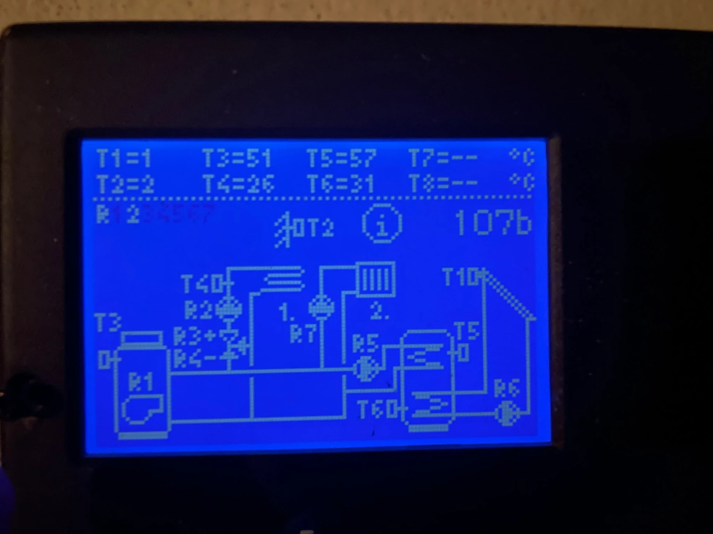

# Wiederaufbau von Null

Reihenfolge, um die Heizungsauslesung komplett neu aufzusetzen (neuer ESP32, neuer PC oder neu
installiertes ioBroker). Stand: 07.11.2026.

## Was man braucht

| Teil | Detail |
|---|---|
| Regler | OEG KMS-D (baugleich Seltron), Hydraulikschema **107b**, Mini-USB-Buchse vorn |
| ESP32 | ESP32-S3-DevKitC-1 mit zwei USB-C-Buchsen: **UART** (CH343, COM-Port) und **USB** (nativ, OTG) |
| Kabel | USB-C ↔ **Mini-USB** mit Datenleitungen (reine Ladekabel gehen nicht) |
| Strom | ESP32 über die **UART**-Buchse versorgen (PC oder USB-Netzteil). Lötbrücke „USB-OTG“ **nicht** nötig, der Regler braucht keine 5 V auf VBUS. Bei geschlossener Brücke den USB-Port nie mit dem PC verbinden. |
| PC | Windows, Git, PlatformIO (VS Code oder `pio`), Python 3 |
| ioBroker | Raspberry Pi `192.168.178.44`, Adapter: `admin`, `mqtt` (Broker, Port 1883), `influxdb`, `javascript`, `vis`, `flot`, `vis-justgage`, `web` |



## 1. Firmware

```
git clone https://github.com/Danielxyz123/OEG-KMS-D-Heizung-ESP32-S3-USB-Host.git
cd OEG-KMS-D-Heizung-ESP32-S3-USB-Host/firmware
copy include\secrets.h.example include\secrets.h     # WLAN + MQTT-Server eintragen
copy secrets.ini.example secrets.ini                 # OTA-Passwort frei waehlen
```

- **Pfad ohne Leerzeichen** verwenden, sonst „PubSubClient.h not found“ (Abhilfe in `platformio.ini`).
- Erstes Flashen per Kabel an der **UART**-Buchse: `pio run -e esp32-s3-devkitc-1 -t upload`
  (COM-Port mit `pio device list` finden, „USB-Enhanced-SERIAL CH343“).
- Danach Updates per WLAN: `pio run -e ota -t upload` (Hostname `oeg-kmsd.local`).
  Windows-Firewall einmalig, PowerShell als Administrator:
  `New-NetFirewallRule -DisplayName "ESP32 OTA 32233" -Direction Inbound -Protocol TCP -LocalPort 32233 -Action Allow -RemoteAddress LocalSubnet`

## 2. Anschließen und prüfen

1. Regler per Mini-USB an die **USB**-Buchse (nativ) des ESP32.
2. Serieller Monitor an der UART-Buchse (`pio device monitor`, 115200): Es erscheinen
   `[USB] Geraet: VID=… PID=…`, `[USB] CDC-Geraet bereit`, `[MQTT] verbunden`.
3. In ioBroker unter Objekte muss `mqtt.0.oeg_kmsd` mit `t1`…`t6`, `relay.r1`…`r8`, `status = online`
   auftauchen. Werte mit dem Regler-Display vergleichen (Taste „i“ → Temperaturen T1…T8).

## 3. ioBroker einrichten

```
pip install websocket-client
python tools/iobroker_setup.py --host 192.168.178.44:8081                                   # Probelauf
python tools/iobroker_setup.py --host 192.168.178.44:8081 --apply --nav-view CurrentData    # ausfuehren
```

Das Skript ist mehrfach ausführbar und richtet ein:
- JavaScript-Skript `Heizung_Brennerleistung` (Wärmeleistung, Tageswerte, Heizlast-Schätzung)
- Datenpunkt `0_userdata.0.Heizung.Analyse_Zeitraum`
- Namen, Einheiten und InfluxDB-Logging für alle Datenpunkte aus `iobroker/datapoints.json`
- vis-Seiten `Heizung`, `Heizung_Schema`, `Heizung_Analyse` (vorher Sicherung von `vis-views.json`)
- Button „Heizung“ auf der Startseite (`--nav-view`, Position mit `--nav-pos links,oben`)

Fehlen Datenpunkte, weil der ESP32 noch nicht sendet, nennt das Skript sie: später erneut ausführen.
Danach den vis-Editor neu laden.

## 4. Annahmen der Heizlast-Auswertung

Stehen oben in `iobroker/Heizung_Brennerleistung.js`; nach Änderung `iobroker_setup.py --apply`.

| Konstante | Wert | Quelle |
|---|---|---|
| `BURNER_KW` | 27 kW | Typenschild; genauer: Düse (gph) und Pumpendruck aus dem Wartungsprotokoll |
| `ETA` | 0,90 | Niedertemperaturkessel |
| `THETA_NA` | −10 °C | 49328 Melle (DIN/TS 12831-1) |
| `PERSONS` | 4 | Warmwasserzuschlag 0,25 kW/Person |
| `WP_KW` | 10 kW | Bosch Compress AW 10 bei A−10/W35 |
| `DG_ZUSATZ_KW` | 1,9 kW | Dachausbau: DG +2–2,8 kW, Decke zum Dachboden −0,5 kW |
| `LOG_START` | 07.11.2026 18:35 | Beginn der Relais-Aufzeichnung |

## Wichtig zu wissen

- **Nur lesen.** Die Firmware schreibt nie in den Regler. Schreiben ginge über Modbus-Funktion 16,
  ist aber nicht erforscht (laut ced2git: Register 6 = Betriebsart).
- **Register-Scan**: `python tools/scan.py 192.168.178.44 0 199 scan.json` (über MQTT,
  ESP32 muss laufen). Einstellwerte liegen ab Register 1000, Zuordnung noch offen.
- **Rücklauf**: kein Fühler am Regler (T7/T8 frei). Abgelesen am Zeigerthermometer.
  Nachrüstbar als DS18B20 am ESP32 oder als T8 (Parameter S1.5).
- **vis 1 aktiv**, nicht vis-2. Bindings mit Formeln dürfen im Ausgabetext kein `;` enthalten
  (also kein `&deg;`, `&#…;` – stattdessen das Zeichen selbst).
- **Flot**: gemeinsame Y-Achse über `commonYAxis` = Index der Bezugslinie **+ 1**.
- Der Regler zeigt Display-Werte gerundet; der ESP32 liefert Zehntelgrad.
- Vollständiges ioBroker-Backup: BackItUp (täglich 02:40 auf das NAS). Konfigurationsverlauf:
  Repo `IO-Broker-Backup` (`backup.bat`).
